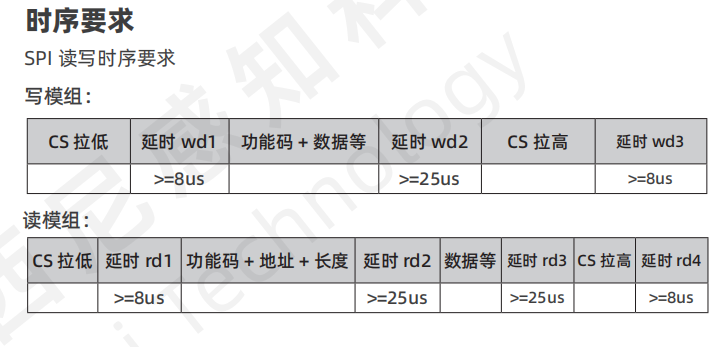

# 从驱动板 CAN 角度与指尖力上报修改计划

> 执行状态：用户已授权按计划修改代码，源码已落地并完成静态审阅，用户随后确认编译通过；本会话未运行自动化测试或烧录。执行记录见同目录2026-10-21-can-telemetry-progress.md。未勾选的人工/真机验收项目留待用户后续执行。

**目标：** 保留 USART1 MODBUS 控制，为地址 0x02 的从板增加 CAN1 反馈，中指、无名指、小指沿用 motor1、motor2、motor3。

**架构：** 单一采集任务按固定 100 Hz 周期完成 ADC 有限长度采集及三路 SPI 轮询，在任务本地处理后发布完整反馈缓存；100 Hz 电机控制和独立 CAN 任务读取一致快照。反馈缓存用短临界区复制，与 MODBUS/电机寄存器互斥锁分离，临界区内不做采集、计算或发送。CAN 使用 MODBUS 配置的公共频率，默认 20 Hz，不触发 ADC/SPI 读取，也不等待新采样。第一版使用周期自动上报，查询模式另行确认后增加。

**技术栈：** STM32F407、STM32 HAL、FreeRTOS/CMSIS-RTOS2、SPI3、CAN1 标准数据帧。

**需求依据：** 本文“已确认约束”和“已确认协议”为用户要求；数据有效期、故障重试间隔等仍标明为建议值。

## 已确认约束

- 项目目录：D:\project\Paper\FR_Hand_s_ts。
- MODBUS 继续使用 USART1，从地址 0x02；现有 motor0～motor3 目标寄存器编号和控制编码保留。
- CAN1：PA11 为 RX，PA12 为 TX；第一路 SPI 软件片选改到 PA8。
- 中指、无名指、小指分别对应 motor1、motor2、motor3，不改为 motor0～2。
- CAN 波特率暂定 875 kbit/s。
- 上报频率由 MODBUS 配置，两条 CAN 信息共用频率，默认 20 Hz，即每 50 ms 上报一组角度和力；两类数据直接从缓冲区读取，上报不额外触发采集。
- MODBUS 支持两条 CAN 信息自动上报的统一启停，默认启动；关闭上报不关闭传感器采集和电机控制。
- SPI 片选 PA8、PD1、PD2 依次连接中指、无名指、小指。
- 按用户提供的官方 SPI 读写时序图修正 TIM13 和 SPI 事务逻辑：图中最小 8 μs 统一实际等待 10 μs，最小 25 μs 统一实际等待 30 μs；SPI3 保持 1.3125 Mbit/s。
- 采用此前讨论的采集优化：统一 100 Hz 采集任务、ADC 有限长度采集、采集与电机控制解耦、短时发布完整缓存，并记录各路时间、有效状态和采集序号。
- ADC1 四路关节通道的采样时间统一改为 ADC_SAMPLETIME_84CYCLES；维持 ADC 时钟 21 MHz、12 位、四通道各 15 点均值。ADC2 掉电检测不并入关节采集重构。
- 0x30 传角度，三指顺序固定为中指、无名指、小指；每指两字节，大端，二进制整数 0～900 表示 0～90.0°。
- 角度帧 DLC=7，D6 为序号。
- 0x31 前六字节传力，每指依次为切向力、法向力；每字节 0～255 表示 0～25.5 N，超量程饱和。
- 力帧 DLC=8，D6 的 bit0/1/2 依次表示中指、无名指、小指的一对力数据是否有效，1 为有效、0 为无效；D7 为序号。
- Reg[18] 的 bit1/2/3 控制 motor1/2/3 采集，默认 0x000E，全开本板三路采集。
- 新增或修改函数的说明、关键逻辑注释均使用中文；函数说明写清函数名、参数、返回值。
- 保留工作区已有改动，不执行覆盖、回退、提交或烧录。

## 实施前代码核对结果（历史快照）

| 位置 | 当前状态 | 修改原因 |
|---|---|---|
| Core/Src/can.c | 已初始化 CAN1，分频 4、BS1=8TQ、BS2=3TQ；未启动收发 | 补充运行和发送逻辑 |
| FR_Hand_s.ioc | APB1=42 MHz，CAN 配置计算值为 875000 bit/s | 保留当前位时序，主板使用相同速率 |
| Core/Src/gpio.c、FR_Hand_s.ioc | 输出配置为 PC8，未配置 PA8 | 与用户指定硬件引脚不一致 |
| Core/Src/Motor.c | 第一片选仍为 PA12 | Tactile_Init/Update 会操作 CAN1_TX 引脚，必须移除该引用 |
| Core/Src/Motor.c | 三个力传感器按 motor0～2 直接索引，名称为食指、中指、无名指 | 与本板 motor1～3 的实际用途不符 |
| Core/Src/rs485.c | Reg[18] 默认 0x0001 | 仅开启原 motor0 采集，不能提供本板三指持续反馈 |
| Core/Src/Tactile_Sensor.c | 已读 Fx/Fy/Fz；未满足 rx[0]!=0 条件时不更新数值，但仍可能返回 HAL_OK | HAL_OK 不能独自证明取得新数据 |
| Core/Src/tim.c、FR_Hand_s.ioc | TIM13 输入 84 MHz、预分频 41，计数频率实际为 2 MHz | Tactile_DelayUs 按计数次数等待，现有实际延时约为参数的一半；需改成 1 MHz |
| Core/Src/Tactile_Sensor.c | 读事务延时参数为 100/300/300/80，写校准事务为 100/300/80 | 改用官方时序对应的读 10/30/30/10 μs、写 10/30/10 μs，缩短不必要等待 |
| Core/Src/freertos.c | Motor_Control_Loop 在电机互斥锁内执行，内部调用阻塞 SPI | 三路采集故障可能拖延控制、MODBUS 与快照读取 |
| Core/Src/adc.c、FR_Hand_s.ioc | ADC1 四通道采样时间为 3 周期，约 0.143 μs | 改为 84 周期，即 4 μs，为输入电压建立提供更长时间 |
| Core/Src/adc.c、Core/Src/freertos.c | 实际 ADC 连续转换、DMA_CIRCULAR；任务注释却按单次 DMA 处理 | 满 60 点后仍覆盖缓冲，完成回调快照不保证稳定，需统一为有限长度采集 |
| Core/Src/freertos.c | ADC 处理完后 osDelay(10)，SPI 跟随独立的电机任务 | 结果更新周期叠加处理和锁等待，ADC 与 SPI 无统一采集节奏 |

## 已确认协议与实现约定

### 三指与传感器映射

| 上报顺序 | 手指 | 电机与关节 ADC 下标 | 力传感器缓存下标 | SPI 片选 |
|---|---|---|---|---|
| 0 | 中指 | 1 | 0 | PA8 |
| 1 | 无名指 | 2 | 1 | PD1 |
| 2 | 小指 | 3 | 2 | PD2 |

电机下标与三个 SPI 接口的接线顺序均已由用户确认。集中维护映射表，禁止在各处散写 i、i-1。

Reg[18] 按电机编号定义：bit1/2/3 控制 motor1/2/3 的采集，默认 0x000E，bit0 在本板不绑定传感器。原先 bit0/1/2 对应前三个力传感器的配置需要同步更新上位机操作说明。采集使能独立于电机运动使能，关闭时保留缓存并清除上报有效位。注意该寄存器的位号是 1/2/3，而力帧有效位的位号是 0/1/2，两者不可直接照搬。

### ADC 与 SPI 统一采集优化

第一版采用固定 100 Hz 的软件采集任务，每 10 ms 启动一轮；采用累计绝对截止时间调度，每轮将目标时刻加 10 个内核 tick，不以本轮结束时刻或实际唤醒时刻重新计算相对周期。遇到超期记录一次超期并跳到下一个未来时刻，不连续补采过期轮次。电机控制继续独立保持目标 100 Hz；CAN 默认 20 Hz，并可通过 MODBUS 调整。

每轮流程为：

```text
采集任务到达本轮截止时间
  → 读取本轮 SPI 使能配置
  → ADC1 启动四通道、各 15 点的有限长度采集
  → DMA 满 60 个半字，快速结束 ADC 连续转换和 DMA 请求
  → 通知任务，任务处理稳定的原始缓冲
  → 四通道分别求本批 15 点均值，换算关节角度
  → 按使能依次读取中指、无名指、小指的 SPI 力
  → 在本地计算切向力、法向力并更新状态、时间与采集序号
  → 用短临界区一次发布完整采集缓存
  → 等待下一个固定采集时刻

电机任务每 10 ms：读取完整反馈快照 → 执行原有控制
CAN 任务按配置频率：读取完整反馈快照 → 打包并上报
```

**ADC 配置与缓冲区：** ADC1 仍使用 PC0～PC3，通道顺序和标定下标不变；21 MHz、12 位、采样时间统一为 84 周期，DMA 改为 DMA_NORMAL，单批长度为 60。ADC 连续扫描仅用于一批内部取得 15 组四通道值，DMA 完成路径必须及时结束 ADC 连续转换和 DMA 请求，不能只把 DMA 改成正常模式后仍让 ADC 持续转换到溢出。先冻结采集，再通知任务处理；不再由循环 DMA 在任务处理期间改写同一缓冲。

DMA 原始缓冲继续位于 DMA 可访问的普通 SRAM，禁止放入 CCM。ADC_Snapshot[60] 如保留，可在采集停止后复制用于原有调试输出；不再依赖循环 DMA 完成中断期间复制 60 个值来保证一致性。只需要满块完成通知，关闭不使用的半传输中断。中断内只完成必要的采集结束、结果状态记录和通知，均值及角度计算留给任务。

每次启动前处理上轮遗留通知、DMA/ADC 错误标志和完成状态，并记录本批编号，禁止上轮通知被误认为本轮完成。检查 HAL_ADC_Start_DMA 返回值；超时或失败时执行有界停止、标记本批无效，不把未完成批次或默认零当作新的有效结果。ADC 等待、SPI 收发及故障处理要服从本轮 10 ms 总预算，单通道异常不得通过累积多个完整超时无限拖延剩余通道和下轮采集。

**滤波与发布：** 本版保留每批各通道 15 点算术平均，明确这不是跨控制周期的滑动平均，也不声称样本均匀分布在 10 ms 内。先在任务本地完成均值、标定换算和力计算，再在短临界区一次性复制成品缓存；电机和 CAN 取缓存也采用同样的短临界区复制。缓存同步不依赖可能被 MODBUS 处理长期持有的电机寄存器锁，SPI、ADC 等待和计算均不在该锁或临界区内执行。

统一缓存至少保存：四通道 ADC 均值和关节角度、三路力结果、ADC 批次有效状态、各路力有效状态、ADC 采集时间、各路力成功读取时间及采集发布序号。采集发布序号与 CAN 上报序号分别维护，CAN 重复读取同一缓存不得刷新采集时间。单路失败时可保留上一有效数值，但本轮有效状态必须能表明失败；某个传感器失败不使其他成功通道失效。ADC 和三路 SPI 仍然顺序发生，同一软件快照不代表严格同时测量。

**84 周期的时间预算：** 采样窗口为 84/21 MHz = 4 μs；单次完整转换为 (84+12)/21 MHz ≈ 4.571 μs；四通道各 15 点共 60 次转换，约 274.29 μs。加三路修正后的 SPI 轮询约 422.86 μs，正常采集流程理论约 697.14 μs，即 0.697 ms，占 10 ms 周期约 6.97%。不包含 HAL、GPIO、任务切换、计算、中断抢占和失败重试开销，不构成真机耗时保证。实际精度仍取决于霍尔输出阻抗和 ADC 前端电路。

本轮采样时间调整范围为 ADC1 四路关节输入，ADC2 掉电检测保持独立；不连带修改其采样策略、判断阈值或消抖逻辑。

**后续可选优化，本版不实施：** 如需均匀采样或进一步分析力角动态关系，可考虑定时器触发 ADC 与双缓冲，例如每通道 1500 次/秒、每 10 ms 汇总 15 点；实施前必须核对 ADC 支持的触发源与现有 PWM/编码器定时器占用。SPI DMA、跨周期滤波、插值对齐也留到有实际需求和耗时依据后增加。

### 官方 SPI 时序与定时器修正

依据用户本轮提供的官方时序截图，原图随计划保存在项目内：



截图只规定 CS 边沿与传输阶段之间的最小等待时间，不包含完整的命令格式、响应状态位定义或校准完成时间；本次不据此推断或改写这些未给出的协议内容。

**TIM13：** 项目当前 APB1 时钟为 42 MHz，TIM13 输入时钟为 84 MHz。预分频改为 83，使计数频率为 84 MHz / (83+1) = 1 MHz，即 1 tick = 1 μs；同步修改 Core/Src/tim.c 与 FR_Hand_s.ioc。保持自由运行、向上计数和 65535 的自动重装值，保持调度前启动 TIM13 的顺序。Tactile_DelayUs 使用 uint16_t 无符号计数差处理一次回绕，不在等待过程中反复清零计数器，防止其他使用者的计时被破坏。该函数仅由现有串行 SPI 事务路径使用。

**读取一个传感器的事务：**

| 阶段 | 官方最低要求 | 计划实际等待 |
|---|---|---|
| 拉低 CS → 发送命令前，rd1 | ≥8 μs | 10 μs |
| 发送命令结束 → 开始接收，rd2 | ≥25 μs | 30 μs |
| 接收结束 → 拉高 CS，rd3 | ≥25 μs | 30 μs |
| 拉高 CS → 允许下一事务，rd4 | ≥8 μs | 10 μs |

读取流程固定为：CS 拉低 → 等 10 μs → 发送既有 5 字节读取命令 → 等发送完成且 SPI 不忙 → 等 30 μs → 接收既有 5 字节数据 → 等接收完成且 SPI 不忙 → 等 30 μs → CS 拉高 → 等 10 μs。命令与响应全过程保持同一片选为低，中途不拉高 CS；其他两个片选始终为高。所有微秒间隔由修正后的 TIM13 产生，不使用 RTOS 毫秒延时替代。

**写入事务，包括现有初始化校准命令：**

| 阶段 | 官方最低要求 | 计划实际等待 |
|---|---|---|
| 拉低 CS → 发送命令前，wd1 | ≥8 μs | 10 μs |
| 发送结束 → 拉高 CS，wd2 | ≥25 μs | 30 μs |
| 拉高 CS → 允许下一事务，wd3 | ≥8 μs | 10 μs |

写入流程固定为：CS 拉低 → 等 10 μs → 发送完整命令及数据 → 等发送完成且 SPI 不忙 → 等 30 μs → CS 拉高 → 等 10 μs。初始化时先确保三个 CS 都为高，并满足 10 μs 空闲再开始事务。

Tactile_Init 中额外的 Tactile_DelayUs(10000) 是原有校准完成等待，单独保留为真正的 10 ms，不缩减成 10 或 30 μs。修正计数器后，其时间会从当前约 5 ms 变为约 10 ms；截图不足以确定传感器真正需要的校准时长，后续如有专门要求再调整。原有校准命令和读取命令字节内容保持不变。

异常路径也必须在有界时间内停止 SPI 活动、恢复片选为高并满足 10 μs 事务间隔，清除本次数据有效标志，不携带仍为低电平的 CS 切换到下一传感器。正常路径不添加超出上述要求的固定 100/300/80 μs 等待。SPI3 的现有数据位宽、模式和位序保留，HAL 超时仍单独采用前述建议的有界短超时，不能与这里的微秒协议等待混淆。

**修正后的理论耗时与占用：** 每个传感器发 5 字节、收 5 字节，共 80 bit，纯传输时间为 80 / 1,312,500 ≈ 60.95 μs；加读事务的 10+30+30+10 = 80 μs 等待，单路约 140.95 μs，三路顺序轮询约 422.86 μs，即 0.423 ms。按各路 100 Hz、每 10 ms 轮询三路计算，纯时钟传输占比仍为 1.83%，含协议等待的事务时间占比约 4.23%。这些数值不含 HAL、GPIO、数据处理、中断抢占、调度或异常重试开销，属于理论估算，不代表真机测量。CAN 默认 20 Hz 上报继续从缓存取值，不把 SPI 采集降到 20 Hz。

### 角度帧：标准 ID 0x30，DLC=7

| 字节 | 内容 |
|---|---|
| D0、D1 | 中指角度高字节、低字节 |
| D2、D3 | 无名指角度高字节、低字节 |
| D4、D5 | 小指角度高字节、低字节 |
| D6 | 本组上报序号，与力帧 D7 相同 |

角度在采集或处理任务内使用关节霍尔 ADC 滤波值及各自 ADValue 标定端点换算，并写入角度缓冲区，不使用电机编码器累计的 CurrentAngle。换算后限幅到 0～90°，乘 10 四舍五入保存为 0～900。CAN 任务只读取缓冲区、拆分字节及附加序号。标定端点相等、数值非有限或 ADC 缓存超龄时，本轮不发角度帧，由主板接收超时判无效。

例如 30.0°、45.0°、90.0°，本组序号为 5：`01 2C 01 C2 03 84 05`。CAN 角度为普通二进制整数，不沿用现有 MODBUS 目标角度的压缩 BCD 编码。

### 力帧：标准 ID 0x31，DLC=8

| 字节 | 内容 |
|---|---|
| D0、D1 | 中指切向力、法向力 |
| D2、D3 | 无名指切向力、法向力 |
| D4、D5 | 小指切向力、法向力 |
| D6 | bit0/1/2：中指、无名指、小指力数据有效；bit3～7 固定为 0 |
| D7 | 本组上报序号，与角度帧 D6 相同，0～255 循环 |

沿用代码当前轴定义：切向力为 sqrt(Fx²+Fy²)，法向力为 abs(Fz)。在采集或处理任务更新这些结果及缓冲区，CAN 任务直接取缓存并打包，不重复读取 SPI。这取决于传感器安装方向，若安装改变，需要对应调整。

力先限幅到 0～25.5 N，再乘 10 四舍五入为 uint8_t。255 是合法满量程，不能兼作故障标志。未成功取得新值、通道关闭或缓存超龄时清对应有效位；启动时有效位全为 0，未取得过数据的数值字节为 0。后续失败可保留旧数值，但接收端必须依据有效位使用。

每个上报周期只复制一次角度与力缓冲区，组成同一份软件快照，两帧使用同一个 uint8_t 序号，初值为 0，每个启用的上报周期加 1，255 后回到 0。停止上报时序号暂停，恢复后继续递增。主板可按同一从板的两个反馈 ID 和相同序号配对；丢帧时不得把不同序号拼成一组，旧组在接收超时后丢弃，不能跨序号回绕长期保留。序号标识上报组，不代表 ADC 与三路 SPI 同时采样。

### MODBUS 自动上报控制寄存器

本从板固件的 Reg[19] 和 Reg[20] 当前未分配业务用途，新增以下保持寄存器；文档中的其他步进驱动器也使用过相同地址，但属于不同 MODBUS 设备的寄存器表，不影响本板地址分配。

| 寄存器 | 协议地址 | 建议宏名 | 含义 | 上电默认值 |
|---|---|---|---|---|
| Reg[19] | 0x0013 | CAN_REPORT_REG_ENABLE | 0：同时停止 0x30/0x31 自动上报；1：同时启动 | 1 |
| Reg[20] | 0x0014 | CAN_REPORT_REG_FREQUENCY | 两条信息共用的上报频率，单位 Hz，普通二进制整数 | 20，即 0x0014 |

启停和默认频率由用户提出；以上地址、宏名及频率范围为本计划确定的实现选择。频率范围暂建议为 1～100 Hz，默认 20 Hz。0 Hz 不作为停止命令，停止使用 Reg[19]=0；小于 1 或大于 100 的频率拒绝写入，保留旧值，返回非法数据值异常。Reg[19] 仅接受 0 和 1。

- 功能码 0x03：读取当前开关、频率，可从 0x0013 连续读两个寄存器。
- 功能码 0x06：分别修改开关或频率。
- 功能码 0x10：一次写入 0x0013～0x0014，原子更新开关与频率；先校验完整请求及全部新值，合法后统一提交，禁止只更新一部分。
- 配置运行时生效，无需重启。MODBUS 写入只更新配置并通知 CAN 任务，不能在串口处理过程中等待 CAN 发送。
- 停止时不再提交新的 CAN 反馈帧，并清理尚未发出的旧反馈请求；已经在总线上开始发送的帧可以正常结束。ADC、SPI 缓冲区和 Reg[18] 采集开关继续正常工作。
- 停止期间可以修改频率；重新启动后按照保存的新频率运行。复位后恢复开关 1、频率 20 Hz，本次不增加 Flash 持久化。
- 启停或频率发生变化时重新安排发送截止时间，恢复后经过一个新周期发送第一组，不补发停止期间或旧频率下积压的周期。重复写入相同配置不推迟原定发送时刻。
- 周期由内核 tick 频率与 Hz 换算。对于 30 Hz 等不能整除 tick 频率的配置，使用余数累计安排相邻周期，避免仅用整数除法造成长期频率偏差。
- 接收端超时建议随配置频率调整为 max(150 ms, 3 × 上报周期)；主动停止时由主板将其视为预期的停止状态。

使用示例：Reg[19]=0 停止两条；Reg[19]=1 启动两条；Reg[20]=10 表示两条各 10 Hz；Reg[20]=20 表示两条各 20 Hz，不是两条合计 20 帧/秒。

### 上报方式与两板分工

- 默认每 50 ms 发一帧 0x30 和一帧 0x31，即各 20 帧/秒、合计 40 帧/秒，使用绝对周期唤醒。MODBUS 修改频率后两条同时切换到新频率，上报频率与原有采集、控制频率分开配置。
- 0x30/0x31 专属于本块 0x02 板。另一块板必须分配独立 ID，可建议使用 0x20/0x21，但本次不修改另一项目。
- MODBUS 地址与 CAN ID 分别配置；0x02 不会自动成为 CAN 地址。
- 自动上报便于主板持续获取最新反馈；查询模式便于主板统一安排周期，但增加接收和请求解析。第一版先实现自动上报，暂不加入查询协议。
- 后续若采用主板广播查询，应分配独立请求 ID，各板仍以各自独立的反馈 ID 回复；不让两板以同一 ID 发送不同载荷。
- 力与 ADC 缓存有效期先建议 50 ms；主板对每种反馈 ID 分别按 max(150 ms, 3 × 当前上报周期) 判断接收超时。两项均为可调整的建议值，缓存有效性按实际采集时间判断，不按 CAN 发送时间刷新。

## 实施任务

### 任务 1：统一引脚和三指映射

**涉及文件：** FR_Hand_s.ioc、Core/Src/gpio.c、Core/Src/Motor.c、Core/Inc/Motor.h、Core/Inc/rs485.h、Core/Src/rs485.c。

**接口：** 增加统一的电机到触觉通道查询 `int8_t Motor_GetTactileChannel(uint8_t motor_index)`，返回 0～2，未绑定返回 -1。

- [x] 配置 PA8 推挽输出、上电默认高；第一路传感器片选改为 PA8，其他两路维持 PD1/PD2。核对 PC8 是否仍有其他硬件用途，再决定是否移除其旧配置。
- [x] 在初始化、采集、调试输出、模式6/7的传感器、导纳状态及超限锁定访问中统一使用映射；PID 公式、限值、MODBUS 目标寄存器仍按实际 motor_index 工作。
- [x] motor0 不绑定本板传感器；不因 CAN 上报而使能 motor0。未绑定通道沿用既有无触觉分支。
- [x] 将 Reg[18] 的 bit1/2/3 定义为 motor1/2/3 采集使能，默认值改为 0x000E，并更新文档；保留四路电机硬件映射和 motor1～3 原有关节标定端点。

### 任务 2：修正 SPI 定时、补齐有效性并解除控制锁长期占用

**涉及文件：** Core/Inc/Tactile_Sensor.h、Core/Src/Tactile_Sensor.c、Core/Src/tim.c、FR_Hand_s.ioc、Core/Src/freertos.c、Core/Src/Motor.c。

**接口：** 触觉缓存补充 `valid`、`last_update_tick`；ADC 缓存补充有效标志和成功更新时间。`Tactile_Update()` 仍返回 HAL 状态，同时明确记录本次是否取得新值。

- [x] TIM13 的预分频从 41 改为 83，同步 .ioc，使计数周期为真正的 1 μs；保留计数器回绕处理和调度前启动顺序，检查全部 Tactile_DelayUs 调用，避免仅改调用参数却继续使用 0.5 μs 的计数基准。
- [x] 依官方截图重写 Tactile_Update 的等待和片选流程：rd1/rd2/rd3/rd4 分别为 10/30/30/10 μs；发送和接收均实际完成、SPI 不忙后才开始后续等待，不增加 CS 中间跳变。
- [x] 同步调整 Tactile_Init 的写事务为 wd1/wd2/wd3=10/30/10 μs，初始化空闲片选等待为 10 μs；单独保留校准完成等待 10 ms，命令字节不变。
- [x] 异常或超时后有界结束 SPI 活动、恢复所有片选的正确状态并保留事务间隔，清除有效标志，禁止在时钟仍活动或某一路 CS 仍为低时切换下一传感器。
- [x] 将运行期 SPI3 读取交给现有传感器任务单独执行，电机控制循环仅使用缓存，避免重复读取。
- [x] 传感器任务短时复制使能掩码，释放配置锁后执行 SPI；任务本地暂存完整三轴数值、状态和更新时间，与本轮 ADC 结果一起按任务 3 的短临界区规则发布，避免其他任务读到半更新数据。
- [x] 将每次 SPI HAL 等待从 1000 ms 改为有界短超时，初步建议 2 ms；故障通道建议间隔 100 ms 重试。协议微秒等待严格按上述读 10/30/30/10、写 10/30/10 μs 执行，保持 SPI3 为 1.3125 Mbit/s。
- [x] 只有 HAL 收发成功且满足当前代码的数据更新条件，才刷新缓存和成功时间；未满足条件不伪装成新样本。不根据未知字段臆造校验规则。
- [x] 各路 SPI 顺序采集，记录各自时间；本版仅保证软件快照一致，不承诺力角严格同步。
- [x] 在采集或处理阶段更新三指角度、切向力、法向力的反馈缓冲区及有效状态，CAN 上报路径不触发硬件采集；采集和电机控制仍按原有节奏运行。

### 任务 3：实现 ADC 有限长度采集与统一 100 Hz 采集任务

**涉及文件：** Core/Src/adc.c、Core/Inc/adc.h、FR_Hand_s.ioc、Core/Src/freertos.c、Core/Src/Motor.c、Core/Inc/Motor.h；需要新增 ADC 错误回调时在 freertos.c 的用户代码区维护。

**接口：** 保留任务入口 `void vSensorProcessTask(void *argument)`，将其改为统一 ADC/SPI 采集任务。ADC 完成及错误回调向任务报告本批结束状态；统一的 SensorFeedbackSnapshot_t 包含四路 ADC/角度与三路力及各自有效状态、时间、采集序号。缓存的发布与读取函数内部采用短临界区复制，调用方无需持有电机寄存器互斥锁。

- [x] ADC1_IN10～IN13 全部使用 ADC_SAMPLETIME_84CYCLES，保持 21 MHz、12 位、原有顺序；同步 .ioc，ADC2 不随本任务改动。
- [x] 将 ADC1 DMA 改为 DMA_NORMAL，长度 60；DMA 满块后及时结束 ADC 转换和 DMA 请求，消除循环覆盖和处理期间继续转换造成的风险；关闭不需要的半传输通知。
- [x] 启动前清理旧通知并核对上一批停止状态，检查启动返回值；处理中断、超时和启动失败，确保任务只处理本批完整且稳定的缓冲。
- [x] 保留原始 DMA 缓冲的普通 SRAM 位置；保留调试所需的原始快照语义，修改与旧 DMA 模式不符的注释。
- [x] 每轮在锁外完成四路各 15 点平均、角度换算、三路 SPI 及力计算；为失败、关闭、过期结果保留明确有效状态。
- [x] 采用累计绝对截止时间安排固定 100 Hz，超期跳过旧周期并计数；给 ADC/SPI 整轮设置总时间预算，避免故障连续拖延采集。
- [x] 统一在短临界区发布成品缓存，电机任务读取缓存后运行原有 PID，CAN 仅取同一缓存；不让反馈缓存读写等待 MODBUS 的寄存器锁。
- [x] 维护 ADC 批次时间、每个力传感器成功更新时间及独立采集序号，不以 CAN 发送时间或快照复制时间伪造新采样；不宣称统一批次是同时采样。

### 任务 4：实现 CAN 快照与编码模块

**新增文件：** Core/Inc/can_telemetry.h、Core/Src/can_telemetry.c。

**其他文件：** Core/Inc/Motor.h、Core/Src/Motor.c、CMakeLists.txt。

**接口：** `Motor_GetTelemetrySnapshot(MotorTelemetrySnapshot_t *snapshot)` 从任务 3 的成品采集缓存中复制三指已处理的角度、切向力、法向力、有效状态和更新时间，内部通过短临界区保证一致性；调用方无需持有电机寄存器锁，不做 ADC、SPI 或 CAN 操作，也不等待新数据。

`CanTelemetry_Encode(const MotorTelemetrySnapshot_t *snapshot, uint32_t now_tick, uint8_t sequence, uint8_t angle_data[7], uint8_t force_data[8])` 在锁外打包缓存数据，返回角度帧是否可发送，力的有效性放入 D6；角度 D6 与力 D7 写入相同序号。

- [x] 定义快照结构和统一单位，明确下标顺序为中指、无名指、小指。
- [x] 在缓存生产端完成角度标定换算及切向/法向力计算；编码端完成范围保护、角度大端拆分、力饱和量化及序号填入。
- [x] 实现采集关闭、启动无数据、读取失败及缓存过期的有效位规则。
- [x] 新源文件加入顶层 CMakeLists.txt 的用户源文件列表，底层 can.c 继续由现有 CubeMX 列表管理。

### 任务 5：启动 CAN 并接入独立上报任务

**涉及文件：** Core/Src/can.c、Core/Src/main.c、Core/Src/freertos.c、Core/Src/can_telemetry.c、Core/Inc/can_telemetry.h；需要错误中断时再补 Core/Src/stm32f4xx_it.c 与对应头文件。

**接口：** `HAL_StatusTypeDef CanTelemetry_Init(void)` 完成 CAN 上报运行初始化；`void CanTelemetry_Process(uint32_t now_tick)` 处理一次有界发送和故障维护；任务入口 `void vCanTelemetryTask(void *argument)`。

- [x] 保留 CAN 当前 875 kbit/s 位时序，正常模式启动 CAN1；纯上报阶段不接受业务查询，接收过滤规则按此配置，不采用全接收后无人清 FIFO 的方式。
- [x] 上报任务优先级低于电机控制与 MODBUS；通过短临界区读取成品反馈快照，在临界区外编码和发送；读取反馈不依赖电机寄存器锁，不等待新采样。
- [x] 按公共频率寄存器安排绝对周期，默认 20 Hz/50 ms；每周期使用一份缓存快照和一个共同序号，发送 DLC=7 的角度帧与 DLC=8 的力帧；序号按启用的周期递增，跳过或丢失的周期允许产生序号缺口。
- [x] 响应 MODBUS 的启停和频率更新通知，停止时不发新反馈、清理未发出的旧请求，恢复或改频时重新安排周期；上报任务等待配置通知或发送截止时间，避免低频配置使启停命令长时间得不到处理。
- [x] 使用 HAL_CAN_GetTxMailboxesFreeLevel / HAL_CAN_AddTxMessage 非阻塞入邮箱。没有容量时跳过过期周期，不积压历史帧，不等待发送完成。
- [x] 保留当前不自动重传的设置，记录发送失败、丢帧和总线错误；建议开启自动 Bus-Off 恢复。维护超时未结束的邮箱请求，避免断线后持续发送旧帧。
- [x] CAN 初始化失败、无 ACK、Bus-Off 或断线只进入 CAN 故障处理，不能通过新增逻辑调用 Error_Handler 停止电机任务和 MODBUS。
- [x] 优先使用静态任务存储，结合项目现有约 15 KB RTOS 堆预算确定栈大小，避免为上报添加不必要的大缓冲区。

### 任务 6：扩展 MODBUS 上报配置

**涉及文件：** Core/Inc/rs485.h、Core/Src/rs485.c、Core/Src/freertos.c、Core/Inc/can_telemetry.h、Core/Src/can_telemetry.c。

**接口：** rs485.h 定义 CAN_REPORT_REG_ENABLE=19、CAN_REPORT_REG_FREQUENCY=20，及默认开关 1、默认频率 20 Hz、建议范围 1～100 Hz。`void CanTelemetry_NotifyConfigChanged(void)` 在有效配置实际变化后通知 CAN 任务，不能阻塞 MODBUS 处理。

- [x] Modbus_Init 初始化两个寄存器的默认值；0x03 支持直接读取它们，CAN 初始化及任务创建从寄存器取得同一份默认配置。
- [x] 0x06 写入新增寄存器前校验允许值；非法值保持原配置，返回非法数据值异常，不产生配置变化通知。
- [x] 0x10 对涉及新增寄存器的请求，先校验数量、字节数、实际帧长度、地址范围及全部新值，再统一写入；发现任何非法值时整次请求不写入寄存器、不触发电机或 CAN 副作用。
- [x] 两个配置寄存器在现有电机数据互斥锁保护下整体读取和更新，避免 CAN 任务读到一半的新配置。
- [x] 有效写入实际改变配置时通知上报任务，按统一周期更新两条消息；单纯关闭或改频不改变 Reg[18]、电机使能和已缓存的传感器值。
- [x] 保持原有电机、PID、导纳寄存器的功能和地址；本次不修改主板项目的 MODBUS 转发范围。上位机通过 USART1 访问从地址 0x02 设置这些寄存器。

### 任务 7：补充接收说明与人工验收项目

**新增文件：** docs/CAN_Telemetry_Protocol.md。

**修改文件：** docs/Admittance_Control_Protocol.md。

- [x] 记录标准帧类型、ID、DLC、字节顺序、单位、无效数据规则、周期与超时、板间 ID 分配。
- [x] 更新本板手指映射、片选、Reg[18] 的位定义和默认值；明确采集使能不会启动电机。
- [x] 记录 Reg[19]/Reg[20] 的地址、默认值、功能码、取值范围、动态生效和复位行为，并提供读写示例。
- [ ] 人工验收参考：0°/45°/90°编码、ADC 两种变化方向及端点相等、力为0/25.5/超量程、NaN/Inf、采集关闭、HAL失败、未取得新值、缓存过期、断开CAN及恢复、两板同时发送、50 ms 上报间隔、两帧同序号及 255 回绕到 0、力帧有效位 0x00/0x01/0x02/0x04/0x07。
- [ ] 真机重点核对 motor1/2/3 与三个传感器实际顺序、Z轴方向、三路读取后的控制周期、875 kbit/s 通信和主板超时处理。
- [ ] 用户后续真机验收参考：使用逻辑分析仪检查 SCK=1.3125 MHz、读 rd1/rd2/rd3/rd4 不小于 10/30/30/10 μs、写 wd1/wd2/wd3 不小于 10/30/10 μs、命令与响应之间 CS 持续为低、三路片选互斥，以及三路正常轮询耗时；本次不运行该验证。
- [ ] 人工验收新增配置：上电默认启动且两条各 20 Hz、停止后采集与控制继续、10/20/30/100 Hz 同频切换、停止期间改频后恢复、重复写相同值不推迟发送、非法开关和 0/101 Hz 被拒绝、0x10 校验失败不产生部分写入、复位恢复默认值。
- [x] 更新 ADC 采集说明：84 周期/4 μs 采样窗口、DMA 正常模式、每批四通道各 15 点平均、固定 100 Hz 采集、控制与 CAN 从缓存取值，删除与现状不符的循环 DMA 无竞态或滑动平均表述。
- [ ] 用户后续人工验收参考：ADC 满块后缓冲稳定、无重复完成中断风暴、无上轮残留通知、启动失败和超时能恢复、100 Hz 周期不因处理累积漂移、四路均值及角度正确、三路力顺序正确、MODBUS 通信时反馈发布仍可正常执行、各通道时间和有效状态正确；本次不执行测试。

## 本轮已确认的选择

1. SPI 片选 PA8/PD1/PD2 依次连接中指、无名指、小指。
2. 默认每 50 ms 自动上报，即 20 Hz；角度和力直接从缓冲区取，不为上报额外采集。
3. 力帧 8 字节，D6 的 bit0/1/2 为三指有效位，D7 为序号；角度帧 7 字节，D6 为序号。同一上报组两帧共用序号。
4. Reg[18] 的 bit1/2/3 对应 motor1/2/3，默认 0x000E 全开采集。
5. MODBUS 可以统一启停两条 CAN 自动上报，默认启动；可以设置两条共用的上报频率，默认 20 Hz。寄存器地址拟分配为 Reg[19]/Reg[20]。
6. 按官方截图修正 SPI 读写时序；8 μs 统一等待 10 μs、25 μs 统一等待 30 μs；TIM13 改为 1 MHz 计数，当前时钟下预分频为 83。修正后理论三路轮询约 0.423 ms。
7. 将此前讨论的采集优化纳入本版：ADC 有限长度采集、固定 100 Hz 统一采集任务、采集与控制解耦、完整缓存短时发布、时间与有效状态追踪。
8. ADC1 四路关节输入的采样时间统一延长至 84 周期，实际采样窗口为 4 μs；四通道各 15 点理论约 0.274 ms，加三路 SPI 理论约 0.697 ms。ADC2 掉电检测不随关节采集重构改动。

## 参考与验证边界

当前位时序由项目文件确认：42 MHz / [4 × (1+8+3)] = 875 kbit/s，采样点为 75%。计算方法参见 [ST bxCAN 位时序说明](https://community.st.com/stm32-mcus-60/can-bxcan-bit-time-configuration-on-stm32-mcus-135466)。主板需要相同位速率；现有参数的实际线路裕量仍需真机判断。

本计划已按用户授权实施，源码与配置已修改，用户随后确认编译通过；本会话未执行自动化测试或烧录。计划中的人工/真机验收项目尚未确认完成。
